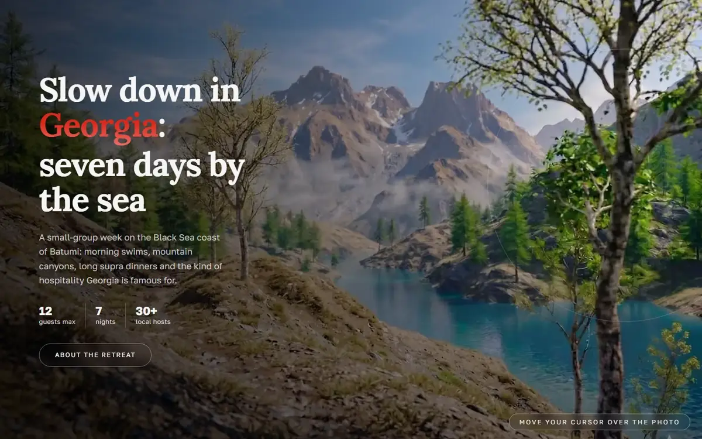
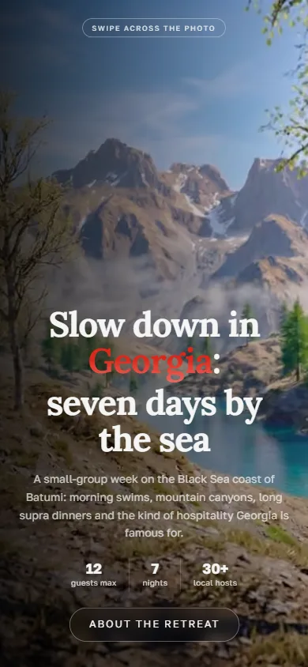
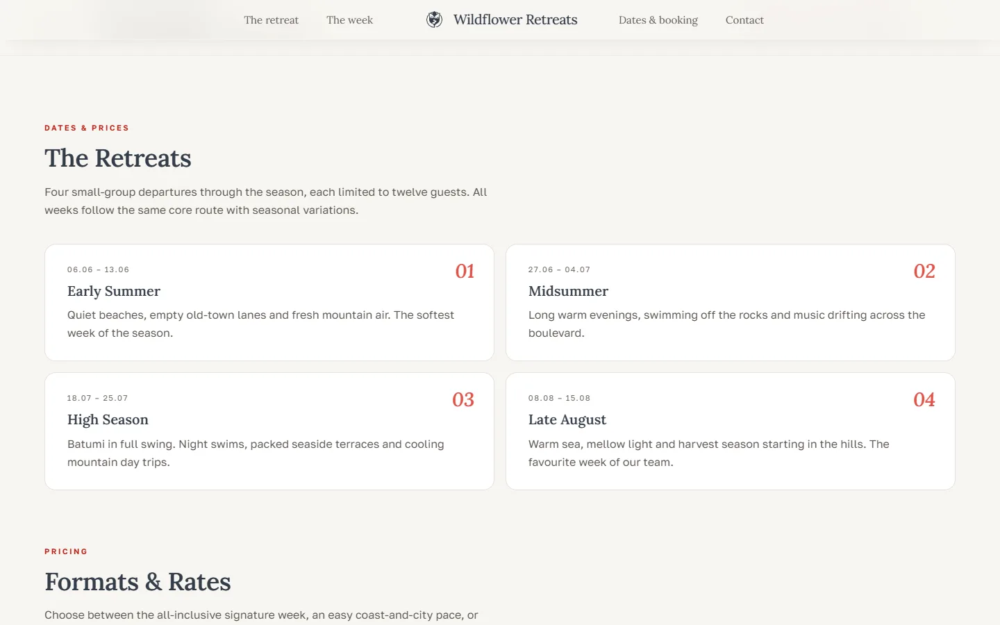
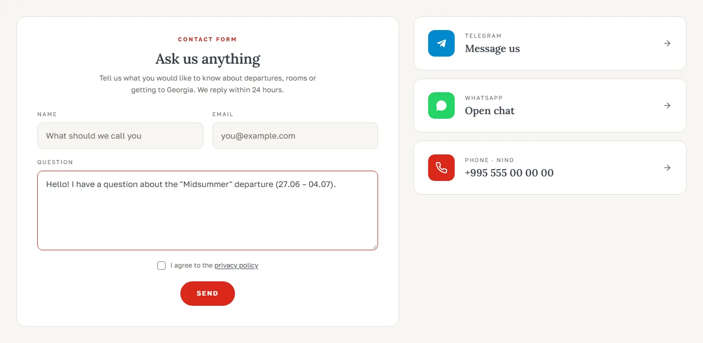
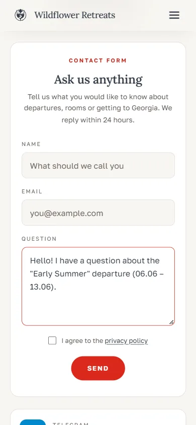

# Wildflower Retreats

An English demo of a website I made for a kids' summer camp package in Batumi, Georgia, together with the package's name, brand and copy, in about a week of focused work; a designer finished the logo by hand. Later I made the production site fast: PageSpeed on mobile went from 76 to 98, and a photo now loads in 0.2 s instead of 15-17 s.

The demo keeps the production site's layout and code and swaps the copy for a fictional offer: a small-group travel week with made-up prices and contacts.

**Live demo:** [puregeo-demo.vercel.app](https://puregeo-demo.vercel.app/) · **Case study:** [stratosly.com/cases/strana-tsvetov](https://stratosly.com/cases/strana-tsvetov)



## What to look at

### The lens on the first screen

Two stacked AI-generated landscapes. The cursor works like a flashlight: a radial-gradient mask on the top image opens a circle onto the brighter one below.

- The hero reads its size once on `mouseenter` and moves the mask inside `requestAnimationFrame`, so a mouse move does not force a layout recalculation.
- On a phone the first 6 px of movement decide the gesture: sideways moves the lens, up and down scrolls the page. Holding a finger still for 140 ms also opens the lens.
- The lower image loads when the browser is idle (3.5 s at the latest), or as soon as a finger or the cursor reaches the hero, so the initial load fetches one hero image, not two. The mask is applied only once that image has loaded: before this guard, a reload with the cursor already over the hero showed an empty grey circle.
- Phones get their own upright crop of both images through `<picture>`, so the photo stays sharp instead of stretching a landscape across a tall screen.



Code: [`Hero.tsx`](src/components/Hero.tsx), [`HeroPhoto.tsx`](src/components/HeroPhoto.tsx).

### The path to an inquiry



Every departure card, every price card and the link for custom dates lead to the form and fill in the question; a departure adds its name and dates. The cards send a browser `CustomEvent` that the form listens for ([`prefill.ts`](src/components/prefill.ts)), so the section with departures and prices stays a Server Component and only the clickable cards and that link are client code ([`ShiftButtons.tsx`](src/components/ShiftButtons.tsx)).





### Speed

The production site runs in a single-core container without a CDN; this demo runs on Vercel. The same code behaved differently in the two, and the production numbers are the ones that mattered. PageSpeed Insights on the production site, desktop on October 26 and mobile on October 27, 2026, both again on October 31:

| | Before | After |
|---|---|---|
| Mobile | 76 | 98 |
| Desktop | 60 | 99 |

On the live site a photo took 15-17 s to load before the build-time cut described below, and 0.2 s after it.

- **Photos were resized during visits.** By default Next.js resizes a photo for each screen width on its first request. On Vercel a separate service does that; in production the site did it on its one CPU core, every other request waited, and the host wiped the resized files on each restart. Now a script cuts every width and quality right after the build, and a custom image loader points `next/image` at those files, so the server never resizes a photo for a visitor. The code is in the [case study](documents/performance-case-study.md#photos-cut-at-build-time-production-only). Production also serves WebP only: encoding AVIF on the fly took 10 s for the large hero on that core.
- **Blur placeholders blocked the main thread.** They inlined 22 data URLs and pushed the HTML to 276.6 KB. Without them it is 79.2 KB, and mobile Total Blocking Time fell from 1,760 ms to 20 ms in production (0 ms on this demo).
- **Images sized for the device.** Phones used to download the 213 KB desktop file. Tuned `sizes` and `deviceSizes` and the upright crops fixed that: on this demo a phone now gets a crop of about 45-50 KB as AVIF. `images.qualities` lists 60 and 75, because Next.js 16 rounds any other quality to the nearest listed value, 75 by default.

The full investigation, with each cause confirmed or ruled out: [`documents/performance-case-study.md`](documents/performance-case-study.md).

### SEO and accessibility

- Metadata per route, JSON-LD (an Organization and a TouristTrip with its Offer), a sitemap, robots.txt, llms.txt and Open Graph images drawn with `next/og` in the brand's Lora font.
- WCAG AA contrast: white button text on the brand red `#DA291C` measures 4.87:1, above the 4.5:1 that AA asks for. The closed mobile menu is `inert`, and every form field has a label.

### How the code is organised

- Server Components by default. Only seven files are marked `"use client"`: the hero, the header menu, the accordion, the departure and price cards, the contact buttons, the form and the cookie banner.
- Brand colors are CSS variables in [`globals.css`](src/app/globals.css), and components hold no HEX values. Only the web app manifest and the Open Graph image, drawn outside the page CSS, use literal colors.

## Demo and production

- The production site is the camp's Russian-language page. Its repository is private.
- Only production has four things: the form's delivery to Telegram, behind a captcha, a per-IP rate limit and a duplicate check; WebP-only images; the build step that cuts every photo in advance; and an analytics script.
- In the demo, `/api/contact` validates the form and discards it: nothing is stored or sent. The Telegram, WhatsApp and phone buttons open no chat; they put a note in the form that the contacts are fictional.
- Every page and file is sent with `noindex`, and robots.txt leaves crawling open to search engines so they can read it: a page blocked in robots.txt can still show up in search as a bare link. AI search and training bots, which do not all document support for `noindex`, are blocked in robots.txt. The demo stays out of search results and does not compete with the production site.

## Stack

- Next.js 16.2 (App Router), React 19.2, TypeScript in strict mode
- Tailwind CSS 4 and CSS Modules
- `next/font` (Lora, Golos Text), `next/image`, sharp
- Playwright for end-to-end tests
- Vercel (demo)

## How it was built

I led the work end to end and used AI coding agents as tools: Claude Code, OpenAI Codex and Google Antigravity. [`AGENTS.md`](AGENTS.md) holds the rules they work to: design tokens instead of hard-coded colors, Server Components by default, and a branch and a pull request for each change, with a description of what changed and how it was checked. The merged pull requests are [listed on GitHub](https://github.com/ant4x/puregeo-demo/pulls?q=is%3Apr+is%3Amerged).

## Run locally

```bash
npm install
npm run dev
```

## Tests

```bash
npx playwright install chromium
npm run test:e2e
```

The suite sends a question through the contact form on desktop and mobile viewports and checks that the API rejects an invalid email.

## Author

Anthony Fox, [stratosly.com](https://stratosly.com).
